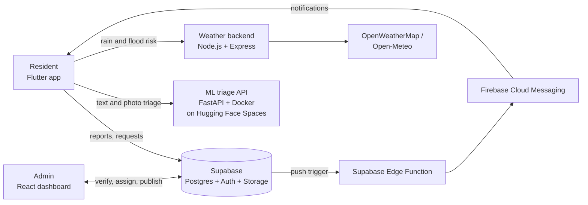

<p align="center">
  
</p>

<h1 align="center">Milaud</h1>

<p align="center">
  <b>A digital governance platform for the residents and local government of Milaor, Camarines Sur.</b><br>
  Flutter mobile app for citizens · React web dashboard for administrators · Machine learning report triage
</p>

<p align="center">
  
  
  
  
  
  
  
  
  
</p>

---

## The problem

In many Philippine municipalities, residents still report emergencies by phone or in person, request documents by lining up at the municipal hall, and hear about announcements and flood warnings by word of mouth. Officials receive reports from many channels with no single place to sort, verify, and track them.

## The solution

Milaud connects residents and the local government in one system:

- **Residents** use the mobile app to report incidents with photos, get flood and rain alerts, request documents, and receive announcements.
- **Administrators** use the web dashboard to verify reports, group duplicate reports into incidents, assign them to a response team, and publish updates that reach residents' phones.

## Key features

### 📱 Mobile app (residents)
- **Citizen reports** with photo evidence, GPS location, and a live detection camera
- **Machine learning severity triage** that suggests a priority level from the report description
- **Photo verification** that checks whether attached photos match the reported emergency
- **Flood alerts and rain forecasts** using live weather data with risk classification
- **Document requests** (barangay clearance, certificates, permits) with status tracking
- **Announcements and push notifications** from the municipality
- **Emergency hotlines**, chatbot assistant, light and dark themes
- Sign-up with OTP verification and password reset

### 💻 Web dashboard (administrators)
- **Report verification workflow**: pending → verified / needs more info / rejected → in progress → resolved
- **Incident grouping**: multiple reports about the same event are shown as one incident, without deleting any original submission
- **Automatic categorization and routing** of verified reports to the Barangay Response Team
- Announcement, document request, and emergency hotline management
- **App customization**: theme changes sync to the mobile app
- Admin roles protected with Supabase row-level security policies

## Machine learning backend

I trained the triage models myself:

- **Text severity classifier** built with Hugging Face Transformers
- **Four PyTorch image models**: fire/flood detection, infrastructure damage, medical emergencies and road crashes, and photo validity
- Several retraining rounds to reduce false positives (for example, raising confidence thresholds and calibrating the road-crash model)

The trained weights are published on my Hugging Face account: **[reygann/mylaud-ml-models](https://huggingface.co/reygann/mylaud-ml-models)**.

📂 **API source code:** [Rksaycon/milaud-ml-triage-api](https://github.com/Rksaycon/milaud-ml-triage-api)

The models are served by a **FastAPI** server, packaged with **Docker** and deployed on a team **Hugging Face Space**. The mobile app calls it when a resident submits a report:

| Endpoint | What it does |
|---|---|
| `POST /classify` | Classifies the report text and suggests a severity level (Low / Medium / High) |
| `POST /verify-image` | Detects what is in a photo and flags a mismatch with the reported category |
| `POST /verify-incident` | Checks 1–3 photos together as one incident, with a multimodal check for harmless look-alikes |
| `POST /notify-high` | Sends an email alert to officials for High-severity reports |

If the ML service is asleep or unreachable, the app falls back to the resident's own selection, so a report is **never blocked** by the AI.

## How the AI is used responsibly

AI in Milaud **assists people, it does not replace them**:

- AI suggestions (severity, category, photo evidence) are shown to admins as *suggestions*, and a human verifies every report before action is taken.
- Automatic routing is only enabled for categories where the model has enough validated training data (**Fire** and **Flooding**). Other categories stay in a human-only workflow.
- Incidents are grouped by the verified category, so one wrong AI prediction can't split a real incident into two.
- API keys stay on the server and are never shipped inside the app.

## Architecture



## Tech stack

| Part | Technologies |
|---|---|
| Mobile app | Flutter, Dart, Riverpod, Dio, Hive, Geolocator, Camera, fl_chart |
| Web dashboard | React 19, Vite, Tailwind CSS, React Router |
| Backend and data | Supabase (Postgres, Auth, Storage, Edge Functions, row-level security) |
| Machine learning | Python, PyTorch, Hugging Face Transformers, scikit-learn, FastAPI, Docker, Hugging Face Spaces |
| Weather service | Node.js, Express, OpenWeatherMap, Open-Meteo |
| Notifications | Firebase Cloud Messaging |
| Testing | flutter_test, Node test runner |

## Project structure

```
├── mobile/              Flutter app for residents
│   ├── lib/
│   │   ├── features/    Rain forecast feature (models, risk rules, services)
│   │   ├── screens/     App screens (reports, documents, flood alert, profile, ...)
│   │   ├── services/    Supabase, AI triage, weather, push notifications
│   │   └── providers/   Riverpod state management
│   ├── supabase/        Database schema, security policies, edge function
│   ├── server.js        Weather and flood alert backend
│   ├── test/            Unit and widget tests
│   └── docs/            User guide, developer guide, API docs
└── web/                 React admin dashboard
    ├── src/             Pages and report logic (classification, verification, grouping, routing)
    ├── tests/           Report logic tests
    └── supabase_*.sql   Database migrations
```

## Getting started

### Requirements
- Flutter SDK 3.x
- Node.js 18 or newer
- A [Supabase](https://supabase.com) project
- An [OpenWeatherMap](https://openweathermap.org/api) API key for the weather backend

### Mobile app
```bash
cd mobile
cp .env.example app.env   # then add your Supabase URL and anon key
flutter pub get
flutter run
```

### Weather backend
```bash
cd mobile
npm install
# set OPENWEATHER_API_KEY in your environment first
npm start                 # runs on http://localhost:3000
```

### Web dashboard
```bash
cd web
npm install
# create web/.env with VITE_SUPABASE_URL and VITE_SUPABASE_ANON_KEY
npm run dev
```

### Database
Run the SQL files in `mobile/supabase/` and `web/` in the Supabase SQL editor to create the tables and security policies.

### Tests
```bash
cd mobile && flutter test
cd web && node --test
```

## Documentation

- [User guide](mobile/docs/USER_GUIDE.md)
- [Developer guide](mobile/docs/DEVELOPER_GUIDE.md)
- [API documentation](mobile/docs/API_DOCUMENTATION.md)
- [Testing guide](mobile/docs/TESTING_GUIDE.md)
- [System architecture](mobile/plans/system_architecture_diagram.md)
- [Web deployment guide](web/DEPLOYMENT_GUIDE.md)

## Author

**Reygann Saycon** (Rksaycon) · [GitHub](https://github.com/Rksaycon) · [Hugging Face](https://huggingface.co/reygann)

Built as a team capstone project for the Municipality of Milaor. I trained the machine learning models. The API is hosted on a teammate's Hugging Face Space.
